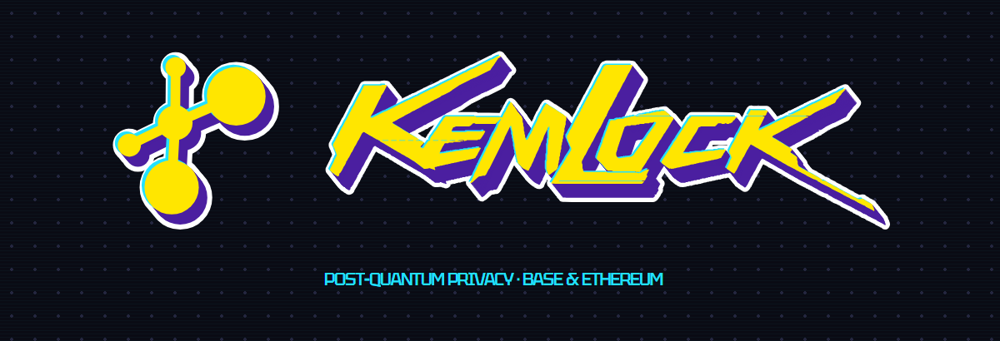

  

<h1 align="center">Private now. Private after quantum.</h1>

  KemLock is a self-custody wallet for Base, Ethereum and Arbitrum One, with a private balance on Base and Ethereum
  sealed by quantum-resistant cryptography. 
  Shield, send and swap without putting your history on display.

  
  &nbsp;
  
  &nbsp;
  
  &nbsp;
  

> **Beta.** Private balance in mainnet beta on Base and Ethereum. Unaudited, with per-asset caps: use small amounts.

<table align="center">
  <tr>
    <th>Note encryption</th>
    <th>Proofs</th>
    <th>Proving</th>
    <th>Trusted setup</th>
  </tr>
  <tr>
    <td align="center">ML-KEM · FIPS 203</td>
    <td align="center">Hash-based, verified on-chain</td>
    <td align="center">On your device</td>
    <td align="center">None</td>
  </tr>
</table>

## Everything a wallet does, with a private balance

<table>
  <tr><td><b>Shield</b></td><td>Move public funds into your private balance.</td></tr>
  <tr><td><b>Private send</b></td><td>Pay a private address. Who paid whom, and how much, stays encrypted.</td></tr>
  <tr><td><b>Private swap</b></td><td>Trade between assets through LI.FI's aggregated liquidity.</td></tr>
  <tr><td><b>Unshield</b></td><td>Move funds back to any public address.</td></tr>
  <tr><td><b>Receipts</b></td><td>Prove one payment to someone, without showing the rest.</td></tr>
</table>

## Public chains never forget

Most on-chain privacy today relies on elliptic-curve cryptography to hide who paid whom. A large enough quantum
computer, running Shor's algorithm, would break that math, and anyone who saved the data could read years of history at
once. KemLock encrypts every note with **ML-KEM**, the key-encapsulation standard NIST published as FIPS 203. The
ciphertext you leave on-chain is built to stay sealed, now and later.

## Security

KemLock is beta software and it has not had an independent security audit yet. If you find a security problem, please
tell us privately before you tell anyone else: write to **security@kemlock.com**. The full policy is at
[kemlock.com/security](https://kemlock.com/security/).

## Find us

[kemlock.com](https://kemlock.com) · [X](https://x.com/kemlock) · [Discord](https://discord.gg/SSf6zJ38Pm) · [YouTube](https://www.youtube.com/@KemLockWallet) · [support@kemlock.com](mailto:support@kemlock.com)

KemLock is built by Kotav Labs. This organisation does not host KemLock's source code yet.

